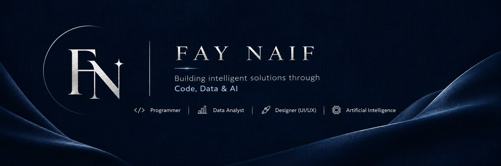

  

  
  
  

## About

I'm a software developer and data analyst studying Computer Science at **Prince Musaid bin Abdulrahman University**.
I work across web technologies, data visualization and digital product prototyping, and I founded and lead **Saudi Compass**, a tourism discovery and trip-planning platform where hands-on building meets product thinking and team coordination.

## Currently

- Leading product direction and prototype development for **Saudi Compass**
- Building machine learning and data analytics projects in Python
- Completing my B.Sc. in Computer Science

## Tech stack

**Languages & web**

  
  
  
  
  
  

**Data & analytics**

  
  
  
  
  

**Design**

  
  

## Projects

### Machine Learning

| Project | Description | Links |
| --- | --- | --- |
| **Energy Consumption Prediction** | Machine learning model (Extra Trees) that predicts household appliance energy use, with an interactive Streamlit app. | [Repository](https://github.com/fay-naif/Energy-Consumption-Prediction) |

### Data Analysis

| Project | Description | Links |
| --- | --- | --- |
| **Healthcare Analytics Dashboard** | Power BI report on hospital visits, billing, collection and patient flow across eight medical centers, with 65 DAX measures. | [Repository](https://github.com/fay-naif/Healthcare-Analytics-Dashboard) |
| **Integrated Business Analysis** | Power BI report on Superstore sales, profit, discounts and returns (2015–2018), with year-over-year analysis and 16 DAX measures. | [Repository](https://github.com/fay-naif/Integrated-Business-Analysis) |
| **Discount Impact Analysis** | One-page Power BI data story showing where Superstore discounts turn profit into loss, with 59 DAX measures. | [Repository](https://github.com/fay-naif/Discount-Impact-Analysis) |
| **Natural Disasters Dashboard** | Arabic Power BI dashboard of natural disasters worldwide (1990–2025) with a world map by continent and KPIs for deaths, people affected and losses. | [Repository](https://github.com/fay-naif/Natural-Disasters-Dashboard) |

### Programming

| Project | Description | Links |
| --- | --- | --- |
| **Saudi Compass** | Tourism discovery and trip-planning platform for Saudi Arabia, with an active prototype and AI-assisted features. Founder and product lead. | [Live site](https://damp-sound-5d86.young-scene-c50a.workers.dev/) |
| **AI Vehicle Inspection** | Vehicle inspection concept exploring AI-assisted condition assessment. | Concept |
| **Learning Fingerprint** | Adaptive-learning prototype focused on tailored learning experiences and progress insights. | Prototype |

## Experience

| Role | Organization | Period |
| --- | --- | --- |
| **Founder & Project Lead** | Saudi Compass | 2026 – present |
| **Technology Trainee** | Aja Space Foundation | 2026 |

## Languages

Arabic (native) · English (intermediate)

---

  Open to collaboration and new opportunities. The best way to reach me is on <a href="https://www.linkedin.com/in/fay-naif-4295663b7">LinkedIn</a>.

